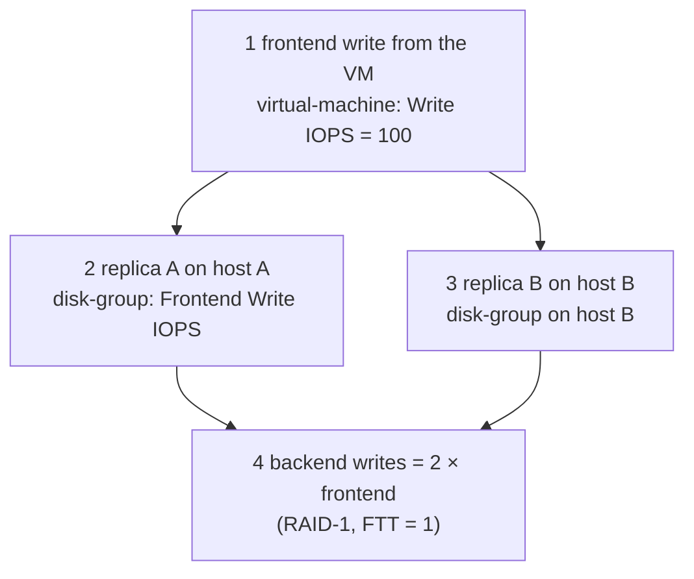

# Metric Formulas

Companion to [README.md](README.md). Each family in 02 to 05 names the entity and label from the performance service (`<entity>` → `<label>`, as listed in [metrics-api.md](../metrics-api.md)). This file gives the calculation behind them.

Status of each formula: **Published** (Broadcom states it), **Derived** (follows from the definition, not a Broadcom statement) or **Not published** (no formula found; described by name only).

## 1. Sampling, rollup and units

| Topic | What the sources say | Status |
|---|---|---|
| Sample interval | The performance service samples every 5 minutes; each value is the average over that window | Published (blog, *Performance Troubleshooting*, 2019) |
| Time window | You select 1 to 24 hours in the vSphere client | Published (same blog) |
| Retention | Up to 90 days, possibly less. Data does not survive the service being turned off and on | Published (same blog) |
| vCenter counters | VCPERF counters carry an rollup suffix: `.average` (mean over the interval) or `.latest` (last sample). The VM counters are named `vsanDomObj.<name>.average` or `.latest` | Published (metrics-api.md, VCPERF rows) |
| Units | Performance-service throughput is in bytes/s and latency in ms (ns for a few virtual-layer counters). vCenter VCPERF throughput is in kBps. Drop and error rates are in per-mille (‰). Percentages are in %. A few labels say `number` but are ratios | Published (API unit column) |
| Mislabelled unit | `vsan-cluster-capacity` → `dedupRatio` is labelled `Space Efficiency Ratio(%)` in the API but is a ratio. Read it as a ratio, e.g. `2.0` = 2:1 | Published unit inconsistency; see [04-capacity.md](04-capacity.md) |

## 2. How the layers relate

A write from a VM is a **frontend** IO. Each vSAN object behind it is written on every replica the storage policy keeps, so the same write becomes **backend** IO. A backend metric is therefore larger than the frontend metric it serves.



- **RAID-1 with FTT=1:** each frontend write is written twice, so backend write IOPS ≈ 2 × frontend write IOPS. A VM doing 100 write IOPS on a RAID-1 object produces 200 backend write IOPS. This is the mirror arithmetic; the blog example in the sources gives the same result (*Derived* from the mirror design; *Published* as an example).
- **Read IOPS:** a read is served by one replica, so backend read IOPS ≈ frontend read IOPS. Read cache hits or misses change which device serves it, not the count.
- **Parity RAID (RAID-5, RAID-6):** write amplification is higher than RAID-1 and depends on the layout. The sources read did not give a factor, so use the ratio of backend to frontend metrics on your own cluster rather than a formula. *Not published.*

## 3. Core formulas

| Metric family | Formula | Status | Note |
|---|---|---|---|
| IOPS (`iops*`, `iopsRead`, `iopsWrite`) | completed IOs in the sample ÷ sample length (seconds) | Derived | Averaged over the 5-minute sample |
| Throughput (`throughput*`, `tputRead`, `tputWrite`) | bytes moved in the sample ÷ sample length (seconds) | Derived | Throughput ≈ IOPS × average IO size |
| Average latency (`latencyAvg*`, `latency*`) | Σ(latency of each completed IO) ÷ number of IOs | Derived; Broadcom describes it as "average latency of IOs" | Per IO, not per second. Whether the average includes network time depends on the layer. The KB 326812 chart text does not say |
| Latency standard deviation (`latencyStddev*`) | standard deviation of IO latency in the sample | Derived from the metric name | Use it to see jitter; a high mean with a low deviation is a steady slowdown |
| Latency split (`latencyDevGAvg`, `latencyDevDAvg`) | `latencyDevGAvg` = guest average, total latency. `latencyDevDAvg` = device average, HBA to backend storage | Published (KB 326812) | Difference = time spent in the ESXi stack above the HBA (LSOM and vSAN queues) |
| Outstanding IO (`oio`, `numOio`) | IOs in flight from the client or layer at the sample time | Published definition ("outstanding IO"); averaging not stated | Relationship to latency: OIO ≈ IOPS × average latency (Little's law) |
| Congestion (`congestion`, `*Congestion`) | scalar 0 to 255. Delay added to IO = randomised exponential backoff based on the value | Published (KB 326479) | Higher value = longer delay. The formula that turns queue state into the 0–255 value is not published |
| Dropped packets (`portRxDrops`, `rxPacketsLossRate`, `ioChainRxdrops`) | dropped packets ÷ total packets × 1000 | Derived; unit ‰ published | |
| Cache hit rate (`rcHitRate`, `cacheHitRate`, `zdom-vtx` rates) | hits ÷ (hits + misses) × 100 | Derived from the metric names. The hybrid read-cache rate is the disk-group `rcHitRate` | Hybrid (OSA) only. The 90% target that some blogs quote is a rule of thumb, not a Broadcom spec |
| Cache miss per IOPS (`iopsCacheMissRate`) | misses ÷ IOPS × 100 | Derived | ESA backend cache (`zdom-vtx`). Not live on the reference cluster |
| Dedup ratio (`dedupRatio`) | space before dedup ÷ space after dedup | Published (vSAN Management API, `VsanSpaceEfficiencyRatio`) | Only reported when dedup is enabled. The API description text says "compression" by mistake; the formula is correct |
| Compression ratio | space before compression ÷ space after compression | Published (same reference) | Only reported when compression is enabled |
| ESA overall ratio | like dedup and compression, but excludes all system overhead | Published (same reference) | |
| ESA global dedup ratio (`dedupEnabledRatio`) | dedup ratio of only the objects eligible for ESA global dedup | Published (same reference) | |
| Object size with overhead | replica size = base × RAID factor, then object = replica + LFS overhead, LFS ≈ 13.1% of replica | Published example (KB 394410) | Example: 10 GB thin RAID-1 → 20 GB replica + 2.62 GB overhead = 22.62 GB. See [04-capacity.md](04-capacity.md) |

## 4. Latency composition

The same IO passes several queues. Each layer's latency includes the layers below it. Use the chart in the middle to pick the metric for the layer you are checking.

```mermaid
sequenceDiagram
    participant VM as VM (virtual-machine, vscsi)
    participant DC as DOM client (host-domclient)
    participant DO as DOM owner (host-domowner)
    participant NET as vSAN network (vsan-vnic-net, vsan-pnic-net)
    participant DG as Disk group (disk-group)
    participant DEV as Device (capacity-disk, cache-disk)
    VM->>DC: IO (latencyRead / latencyWrite)
    DC->>DO: forward (latencyAvgRead on host-domclient)
    DO->>NET: leaf owner or remote owner (readLeafOwnerLatencyLocal / Remote)
    NET->>DG: component write or read
    DG->>DEV: destage, read miss (frontend latency at disk group)
    DEV-->>DG: HBA to backend time (latencyDevDAvg on capacity-disk)
    DG-->>VM: returned; total time (latencyDevGAvg on capacity-disk)
```

Practical reading order when a VM is slow:

1. `virtual-machine` `latencyRead` or `latencyWrite` (what the guest sees).
2. `host-domclient` `latencyAvgRead` or `latencyAvgWrite` (the DOM client on the VM's host).
3. `host-domowner` `readLeafOwnerLatencyLocal` vs `readLeafOwnerLatencyRemote` (is the owner local or across the network?).
4. `disk-group` `latencyAvgRead` or `latencyAvgWrite`, the frontend latency at the disk group (the label is "Frontend Read/Write Latency" in the catalog).
5. `capacity-disk` `latencyDevRead` (physical device), and `latencyDevDAvg` vs `latencyDevGAvg` for the time above the HBA.

## 5. What Broadcom does not publish

These metrics are in the API, but I found no formula or definition beyond the name:

- The Health Score (`healthScore`) and the status counts (`healthStatusCounts.*`). The health check that produces each status is listed in [05-availability.md](05-availability.md).
- How the 0–255 congestion value is computed from the queues in LSOM. The KB names the causes (slab, comp, SSD, log, memory, IOPS) but not the calculation.
- Averaging details: whether a latency average is weighted per IO or per interval, and whether the sample window is the same for every entity type.
- The meaning of the scheduler labels: `Regulator Iops Read`, `Num Ready Delay`, `Dispatched Cost`, `Queue Depth`. The names are published; the formulas are not.
- Thin provision ratio, snapshot saving ratio and space-efficiency ratio on the datastore: names only. Their formulas are not in the sources read.
- Whether a remote-client latency includes network time. KB 326812 does not say.

For these, use the name and compare the value on a healthy cluster, or check the vSAN performance guide for your release.

## 6. Where these formulas are used

- Contention: [02-contention.md](02-contention.md) (congestion, outstanding IO, queues, latency).
- Consumption: [03-consumption.md](03-consumption.md) (IOPS, throughput, backend amplification).
- Capacity: [04-capacity.md](04-capacity.md) (object overhead, ratios, thresholds).
- Availability: [05-availability.md](05-availability.md) (health checks, events, resync).

## Sources

- KB 326479, *Understanding Congestion in vSAN*.
- KB 326673, *vSAN performance diagnostics reports*.
- KB 326812, *vSAN performance graphs in the vSphere web client, part 2*.
- KB 394410, *Storage space utilization calculation for VM's objects on vSAN ESA*.
- vSAN Management API, `vim.vsan.VsanSpaceEfficiencyRatio`.
- VMware Cloud Foundation Blog, *Performance Troubleshooting: Understanding the Different Levels of vSAN Performance Metrics* (2019-06-12).
- [metrics-api.md](../metrics-api.md) and [raw/live.json](../raw/live.json), for entity, label and unit names.
