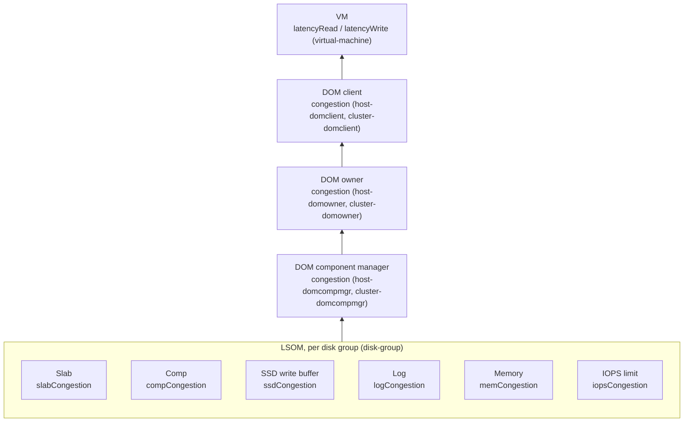

# Contention Metrics

Companion to [01-formulas.md](01-formulas.md). Contention metrics show that IO (or packets, or CPU time) is waiting for a resource: a queue, a slot, a buffer, a lock or a CPU. A contention metric does not count work done. Consumption (IOPS, throughput) is in [03-consumption.md](03-consumption.md).

This file covers five kinds of contention metric:

| Kind | What it counts | Examples |
|---|---|---|
| Congestion | vSAN's flow-control signal (0 to 255) | `congestion`, `ssdCongestion`, `logCongestion` |
| Outstanding IO | IOs in flight, waiting to complete | `oio`, `oioWrite`, `numOio` |
| Queue | IOs or bytes waiting in a scheduler or network queue | `namespaceQueueDepthRead`, `latencySchedQueueVM`, `txQLatAvg` |
| Dropped or errored | packets or IOs lost or rejected | `portRxDrops`, `rxPacketsLossRate`, `ioChainRxdrops` |
| Latency | time per IO spent waiting (the symptom users notice) | `latencyAvgRead`, `latencyStddev`, `readLeafOwnerLatencyRemote` |

Also included: CPU ready time, which is the host waiting for a physical CPU, and cache lock contention.

## 1. How congestion moves up the stack

Congestion is generated at the bottom and aggregated upward. A bottleneck on a disk group raises the lower-layer congestion, which raises the component manager, then the owner, then the client. The VM is the last to see it, as added latency. The KB states that this is flow control: vSAN slows the client instead of letting the queue grow without limit.

Each lower-layer type is a separate limit. Any one of them can throttle the IO above it, which is why a single disk group can show congestion with the others healthy.

## 2. Troubleshooting order

1. **Start at the VM.** Compare `virtual-machine` `latencyRead` and `latencyWrite` with `vscsi` for the disk in question. If the VM is quiet and the latency is high, the cause is below it.
2. **Check the DOM client and owner.** `host-domclient` `congestion` and `oio` on the VM's host. Then `host-domowner` `readLeafOwnerLatencyRemote` vs `Local`: a high remote value points to the network or to a remote owner.
3. **Check the component manager.** `host-domcompmgr` `componentCongestion` and the queue depth labels (`namespaceQueueDepth*`, `vmdiskQueueDepth*`, `resyncQueueDepth*`). Their dispatched cost shows which queue is taking the time.
4. **Check the disk group.** `disk-group` `ssdCongestion`, `logCongestion`, `slabCongestion`, `compCongestion`, `memCongestion`, `iopsCongestion`, and `wbFreePct`. The one with a high value names the bottleneck.
5. **Check the device.** `capacity-disk` `latencyDevDAvg` and `latencyDevGAvg`. A high device latency with low congestion means the drive is slow, not vSAN.

Thresholds from the sources:

- A congestion value of 0 to 255 is normal when it is low and brief. KB 326673 treats a sustained value **above 50** as the level to investigate.
- A controller queue depth **below 100** can cause congestion. Check the controller is on the vSAN HCL.
- KB 326673 gives these remedies for the disk-group types: **SSD**: keep the active working set at or below 40% of the write cache; write cache is 30% of the cache tier for hybrid and the cache tier size (capped at 600 GB) for all-flash. **Log**: check the benchmark uses 4K-aligned IO; if the working set is under 10% of the cache tier, raise it to 40%, otherwise reduce outstanding IO or VM count. **Component**: spread heavy writes across more VM disks. **Memory and slab**: reduce the working set.
- A disk group with much higher congestion than the others means the write IO is unbalanced. KB 326673 suggests increasing the disk stripes in the storage policy.

## 3. Metrics by object type

Entity and label are in the performance service form (`entity` → `label`). Status is *Published* where a Broadcom source defines it, *Derived* where it follows from the name, and *Not published* where neither is available. The congestion scalar is 0 to 255 (KB 326479). The `*Congestion` counters are listed with unit `number`, and their range is not published, so read them against their own baseline.

### vSAN Cluster

| Metric | Entity → label | Unit | Meaning | Status |
|---|---|---|---|---|
| Congestion (VM side) | `cluster-domclient` → `congestion` | number | Aggregated congestion of IO from all vSAN clients (VM and stats object) | Published by name (KB 326479 places it at the DOM client layer) |
| Read / write congestion (VM side) | `cluster-domclient` → `readCongestion`, `writeCongestion` | number | Read and write congestion, split | Published by name |
| Outstanding IO (VM side) | `cluster-domclient` → `oio` | number | IOs in flight from all vSAN clients | Published by name |
| Outstanding IO (device-facing) | `cluster-domclient` → `numOio` | number | Count of IOs outstanding | Published by name |
| Unmap congestion | `cluster-domclient` → `unmapCongestion` | number | Congestion of unmap (TRIM) IO | Published by name |
| Congestion (backend) | `cluster-domcompmgr` → `congestion`, `oio` | number | Backend congestion and in-flight IO at the component manager | Published (KB 326479, backend layer) |
| Congestion (owner) | `cluster-domowner` → `congestion`, `readCongestion`, `writeCongestion`, `oio` | number | Owner-layer congestion, read and write | Published by name |
| Resync queue | `cluster-domowner` → `numPendingResyncJobs`, `numRunningResyncJobs`, `numSuspendedResyncJobs` | count | Resync jobs waiting, running or suspended | Published by name. Background IO: see [05-availability.md](05-availability.md) |
| RDT outbound queueing latency | `cluster-rdt-network-latency` → `txQLatAvg`, `txQLatMax`, `txQLatMin` | ms | Time an outbound message waits in the RDT (vSAN transport) queue | Published by name |
| RDT outbound context queue | `cluster-rdt-network-latency` → `txCtxQAvg`, `txCtxQMax`, `txCtxQMin` | bytes/s | Outbound context bytes queued | Published by name |
| RDT latency | `cluster-rdt-network-latency` → `avgLatency`, `minLatency`, `maxLatency` | ms | Average, minimum and maximum RDT (vSAN transport) latency across the cluster. The API does not say whether it is round-trip | Published by name |
| RDT socket buffer | `cluster-rdt-network-latency` → `rxSbSpaceAvg`, `txSbSpaceAvg` (min and max also) | bytes/s | Socket buffer throughput per socket, inbound and outbound | Published by name |
| RDT ready delay | `cluster-rdt-network-latency` → `numReadyDelay` | count | Delay events on ready state | *Not published* (name only) |
| Keep-alive resets | `cluster-rdt-network-latency` → `kaReset` | count | Keep-alive resets on RDT sockets | *Not published* (name only) |
| Front-end latency (VM side) | `cluster-domclient` → `latencyAvgRead`, `latencyAvgWrite`, `latencyStddevRead`, `latencyStddevWrite` | ms | Average latency and its deviation from all clients | Published by name (average latency, per KB 326812) |

### vSAN Host

| Metric | Entity → label | Unit | Meaning | Status |
|---|---|---|---|---|
| Congestion (VM side) | `host-domclient` → `congestion` | number | Congestion of IO from VMs on this host | Published (KB 326479) |
| Read / write / unmap congestion | `host-domclient` → `readCongestion`, `writeCongestion`, `unmapCongestion`, `segCleanerUnmapCongestion` | number | Congestion split by IO type | Published by name |
| Outstanding IO | `host-domclient` → `oio`, `oioRead`, `oioWrite`, `oioRecoveryWrite`, `oioResyncRead`, `numOio` | number | IOs in flight by type | Published by name |
| Latency jitter | `host-domclient` → `latencyStddev`, `latencyStddevRead`, `latencyStddevWrite`, `latencyStddevUnmap` | ms | Standard deviation of IO latency | Derived from name |
| Owner congestion | `host-domowner` → `congestion`, `readCongestion`, `writeCongestion`, `unmapCongestion`, `oio` | number | Owner-layer congestion and in-flight IO | Published by name |
| Local vs remote owner latency | `host-domowner` → `readLeafOwnerLatencyLocal`, `readLeafOwnerLatencyRemote`, `writeLeafOwnerLatencyLocal`, `writeLeafOwnerLatencyRemote` | ms | Latency of IO that the owner serves locally vs on a remote leaf | Published by name. The rule for choosing local or remote is not published |
| Retries | `host-domowner` → `readLeafOwnerRetriesPerOp`, `writeLeafOwnerRetriesPerOp`, `readOwnerRetriesPerOp`, `writeOwnerRetriesPerOp` | not given by the API | Retries per operation. Retries point to contention or move-induced re-routing | *Not published* (name only) |
| Server switch | `host-domowner` and `host-domclient` → `serverSwitchAvglatency`, `serverSwitchCount`, `serverSwitchLatencyMaxUs` | not given by the API | Latency and count of owner server switches | *Not published* (name only) |
| Component manager congestion | `host-domcompmgr` → `congestion`, `componentCongestion`, `readCongestion`, `writeCongestion`, `recUnmapCongestion`, `resyncReadCongestion`, `sharedCongestion` | number | Backend congestion by path, including the shared path | Published by name |
| Scheduler queue depth | `host-domcompmgr` → `namespaceQueueDepthRead` / `Write`, `metadataQueueDepthRead` / `Write`, `vmdiskQueueDepthRead` / `Write`, `resyncQueueDepthRead` / `Write` | count | IOs waiting in each scheduler queue | Published by name |
| Scheduler dispatched cost | `host-domcompmgr` → `namespaceDispatchedCostRead` / `Write`, `vmdiskDispatchedCostRead` / `Write`, `resyncDispatchedCostRead` / `Write` | count | Cost of IOs dispatched from each queue | *Not published* (name only) |
| Regulator | `host-domcompmgr` → `regulatorIopsRead`, `regulatorIopsWrite` | IOPS | IOPS the regulator allows per direction | *Not published* (name only) |
| Backend latency | `host-domcompmgr` → `latencyAvgRead`, `latencyAvgWrite`, `latencyMaxRead`, `latencyMaxWrite`, `latencyMaxUnmap` | ms | Average and maximum latency at the component manager | Published by name |
| Cache lock contention | `host-vsansparse` → `cacheLockContentions`, `lruLockContentions`, `cacheAllocFails`, `cacheEvictAttempts` | count | Lock waits and allocation failures in the vsanSparse cache | *Not published* (name only) |
| Packet discard, inbound | `vsan-host-net` → `rxPacketsLossRate` (Network Inbound Packet Discard Rate) | ‰ | Discards per thousand packets received on the vSAN vmknic | Derived from the ‰ unit |
| Packet discard, outbound | `vsan-host-net` → `txPacketsLossRate` | ‰ | Same for transmitted packets | Derived |
| Port drops | `vsan-host-net` → `portRxDrops`, `portTxDrops` | ‰ | Drops at the host's vSAN port | Derived from the ‰ unit |
| IO chain drops | `vsan-host-net` → `ioChainRxdrops`, `ioChainTxdrops` | ‰ | Drops in the vSAN IO chain | *Not published* (name and unit only) |
| RDT host latency | `rdt-network-latency` → `avgLatency`, `minLatency`, `maxLatency`, `txQLatAvg`, `txQLatMax`, `txQLatMin`, `txCtxQAvg`, `rxSbSpaceAvg`, `txSbSpaceAvg`, `kaReset`, `numReadyDelay` | ms, bytes/s, count | Host-level equivalents of the cluster RDT metrics | Published by name |
| RDT checksum | `rdt-net` → `checksumMismatchCount` | count | Checksum mismatches on RDT traffic | *Not published* (name only); a non-zero value is worth investigating |
| CPU ready | `vsan-cpu` → `readyPct` (Percentage of Ready CPU Time) | % | Share of time the vSAN world waits for a physical CPU | Published by name. Standard meaning of CPU ready |
| CPU used | `vsan-cpu` → `usedPct`, `runPct` | % | Use of CPU by vSAN worlds (listed under 06 consumption) | Published by name |
| Memory pressure | `system-mem` → `overcommitRatio` (Over Commit Ratio), `pctMemUsed` | number, ‰ | Over-commit ratio and memory used | Published by name |

### Disk Group

The disk group is the LSOM layer. Its congestion family is the most useful part of the performance service for a bottleneck.

| Metric | Entity → label | Unit | Meaning | Status |
|---|---|---|---|---|
| Memory congestion | `disk-group` → `memCongestion` (Mem-Congestion) | number (0–255) | Internal vSAN memory above its threshold | Published (KB 326479); threshold not given |
| Slab congestion | `disk-group` → `slabCongestion` | number | In-flight operations above the operation slab capacity | Published (KB 326479) |
| SSD congestion | `disk-group` → `ssdCongestion` | number | Write buffer full; drain rate sets the speed | Published (KB 326479, 326673) |
| IOPS congestion | `disk-group` → `iopsCongestion` | number | Component IOPS above reservation or limit with disk IOPS at 100% | Published (KB 326479) |
| Log congestion | `disk-group` → `logCongestion` | number | Internal log space on the cache tier is exhausted | Published (KB 326479, 326673) |
| Component congestion | `disk-group` → `compCongestion` | number | Internal component table above its threshold | Published (KB 326479); threshold not given |
| Read and write component congestion | `disk-group` → `componentCongestionReadSched`, `componentCongestionWriteSched` (Read / Write Component) | number | Scheduler congestion at component level, by direction | Published by name |
| Read and write disk group congestion | `disk-group` → `diskgroupCongestionReadSched`, `diskgroupCongestionWriteSched` | number | Scheduler congestion at disk-group level, by direction | Published by name |
| Congestion throughput | `disk-group` → `bytesPerSecondBandwidth` (LogCongestionTput) | bytes/s | Throughput of the log congestion path | Published by name |
| Delayed IO | `disk-group` → `iopsDelayPctSched` (Delayed IO Percentage), `latencyDelaySched` (Delayed IO Average Latency) | %, ms | Share of IO delayed by the scheduler, and the average delay | Published by name |
| Delayed IO count | `disk-group` → `iopsSched` (Total Delayed IOPS), `throughputSched` (Total Queue Throughput) | IOPS, bytes/s | Delayed IOPS and bytes through the queues | Published by name |
| Queue latency by queue | `disk-group` → `latencySchedQueueNS` (namespace), `latencySchedQueueRec` (recovery), `latencySchedQueueVM` (VM), `latencySchedQueueMeta` (metadata) | ms | Latency in each scheduler queue | Published by name |
| Queue IOPS by queue | `disk-group` → `iopsSchedQueueNS`, `iopsSchedQueueRec`, `iopsSchedQueueVM`, `iopsSchedQueueMeta` | IOPS | IOPS through each queue | Published by name |
| Queue throughput by queue | `disk-group` → `throughputSchedQueueNS`, `throughputSchedQueueRec`, `throughputSchedQueueVM`, `throughputSchedQueueMeta` | bytes/s | Throughput through each queue | Published by name |
| Outstanding writes | `disk-group` → `oioWrite`, `oioRecWrite`, `oioWriteSize`, `oioRecWriteSize` | count, bytes | Outstanding write operations and sizes, normal and recovery | Published by name |
| Outstanding bytes | `disk-group` → `outstandingBytesSched` | bytes/s | Outstanding bytes in the scheduler | Published by name |
| Write buffer free | `disk-group` → `wbFreePct` (Write Buffer Free Percentage) | % | Share of the write buffer free. SSD congestion is the write buffer running out of space (KB 326479) | Published by name |
| Read cache invalidations | `disk-group` → `warEvictions` (Cache Invalidations), `quotaEvictions` (Removals) | count | Read-cache entries removed by writes or by quota. High rates reduce the hit rate | Published by name. Hybrid only |
| Frontend latency | `disk-group` → `latencyAvgRead`, `latencyAvgWrite` (Frontend Read and Write Latency) | ms | Frontend latency at the disk group | Published by name |
| Cache layer latency | `disk-group` → `latencyRcRead`, `latencyRcWrite`, `latencyWbRead`, `latencyWbWrite` | ms | Read-cache and write-buffer latency | Published by name |

### vSAN Disk

| Metric | Entity → label | Unit | Meaning | Status |
|---|---|---|---|---|
| Layer delete congestion | `capacity-disk` → `deleteCongestion` | number | Congestion for delete operations in the vSAN layer | Published by name |
| Guest and device latency | `capacity-disk` → `latencyDevGAvg` (guest average), `latencyDevDAvg` (device average) | ms | Total latency seen by the guest and from the HBA to the backend | Published (KB 326812) |
| Physical read and write latency | `capacity-disk` → `latencyDevRead`, `latencyDevWrite` | ms | Device-level latency by direction | Published by name |
| PLOG queue latency | `capacity-disk` → `plogReadQLatency`, `plogWriteQLatency` | ms | Time in the PLOG read and write queues | Published by name |
| PLOG helper queue | `capacity-disk` → `plogHelpRdQLat`, `plogHelpWrQLat`, `plogHelpRdQDepth`, `plogHelpWrQDepth` | ms, count | Helper queue latency and depth | Published by name |
| Outstanding commands | `capacity-disk` → `outstandingCmdCount` | count | Commands outstanding at the device | Published by name |
| Cache-tier queues | `cache-disk` → `latencyRcRdQ`, `latencyRcWrtQ`, `latencyWbRdQ`, `latencyWbWrtQ` | ms | Queue latency for read cache and write buffer | Published by name |
| Cache-tier device latency | `cache-disk` → `latencyDevGAvg`, `latencyDevDAvg`, `latencyDevKAvg` | ms | Guest, device and kernel average latency at the cache device | Published by name |
| Commit flusher queue | `capacity-disk` → `commitFlusherComponentsToFlush` | count | Components waiting to be flushed (verbose only) | Published by name; verbose mode |

ESA (`vsan-esa-disk-layer`, `vsan-esa-disk-scsifw`) carries the equivalent queue and latency metrics for the ESA device layer. They were not returned on the reference cluster (OSA).

### Virtual Machine and Virtual Disk

| Metric | Entity → label | Unit | Meaning | Status |
|---|---|---|---|---|
| Frontend latency | `virtual-machine` → `latencyRead`, `latencyWrite` | ms | What the VM sees: average latency of its IO | Published by name |
| Virtual disk latency | `vscsi` → `latencyRead`, `latencyWrite` | ms | Same per virtual disk | Published by name |
| Read and write congestion (vCenter) | VCPERF `Virtual Machine` → `vsanDomObj.readCongestion.average`, `vsanDomObj.writeCongestion.average` | number | Congestion of the VM's objects, averaged over the sample | Published (metrics-api.md, VCPERF rows) |
| Recovery write congestion (vCenter) | VCPERF `Virtual Machine` → `vsanDomObj.recoveryWriteCongestion.average` | number | Congestion from recovery writes | Published (VCPERF) |
| Max latency (vCenter) | VCPERF `Virtual Machine` → `vsanDomObj.readMaxLatency.latest`, `vsanDomObj.writeMaxLatency.latest` | ms | Maximum latency in the last sample | Published (VCPERF) |
| Normalised IOPS limit | `virtual-disk` → `iopsLimit` (Normalized IOPS Limit) | IOPS | Limit set on the virtual disk | Published by name |
| Normalised IOPS (delayed) | `virtual-disk` → `NIOPS` (Normalized IOPS), `NIOPSDelayed` (Delayed Normalized IOPS) | IOPS | IOPS and the part held back by the limit | Published by name. A non-zero delayed value means the limit is throttling the VM |

### vSAN Network Adapter

| Metric | Entity → label | Unit | Meaning | Status |
|---|---|---|---|---|
| Inbound and outbound discard (vNIC) | `vsan-vnic-net` → `rxPacketsLossRate`, `txPacketsLossRate` (Packet Discard Rate) | ‰ | Discards on the vSAN vmknic | Derived from the ‰ unit |
| vSwitch port drops (vNIC) | `vsan-vnic-net` → `portRxDrops`, `portTxDrops` | ‰ | Drops at the vSwitch port | Derived |
| IO chain drops (vNIC) | `vsan-vnic-net` → `ioChainRxdrops`, `ioChainTxdrops` | number | Drops in the vSAN IO chain | Published by name |
| Physical NIC error rate | `vsan-pnic-net` → `rxPacketsLossRate`, `txPacketsLossRate` (pNIC Packet Error Rate) | ‰ | Errors on the physical port | Derived |
| 802.3x pause | `vsan-pnic-net` → `pauseCount` (pNic 802.3x Pause Rate) | ‰ | Pause frames, flow control in effect | Derived from the ‰ unit |
| Priority flow control | `vsan-pnic-net` → `pfcCount` (Pfc Count) | count | Priority flow control events | Published by name |
| CRC, carrier, overflow, FIFO and missed errors | `vsan-pnic-net` → `rxCrcErr`, `txCarErr`, `rxErr`, `txErr`, `rxMissErr`, `rxOvErr`, `rxFifoErr` | ‰ | Physical-layer error rates by type | Derived from the ‰ unit |
| Physical NIC drops | `vsan-pnic-net` → `portRxDrops`, `ioChainDrops` | ‰ | Drops at the physical vSwitch port and in the IO chain | Derived |
| RDT latency (vNIC) | `vnic-rdt-network-latency` → `avgLatency`, `minLatency`, `maxLatency`, `txQLatAvg`, `txQLatMax`, `txQLatMin` | ms | RDT latency and queue latency per vNIC | Published by name |

Packet error and discard rates are per thousand. A rate of 1‰ means one in a thousand packets. Check them against the number of packets (`rxPackets`, `txPackets`), not against an absolute count.

## 4. What is not in the performance service

- **Hardware queue depth** (`Controllers: Queue Depth`, `Queue Depth On Hcl`) is a property of the host and the controller, not a performance metric. The KB 326673 threshold of 100 applies. See [05-availability.md](05-availability.md) for the health checks that read it.
- **TCP retransmissions and zero windows** (`vsan-tcpip-stats`, for example `tcpSndZeroWin`, `tcpSackRexmitsRate`) are in the API but were not returned on the reference cluster. Their names describe TCP-level contention.
- **ESA global dedup contention** (`*-esa-dedup-*`, 10 entity types, 266 metrics) is in the API but returned no data on the reference cluster. See [metrics-api.md](../metrics-api.md) for the labels.
