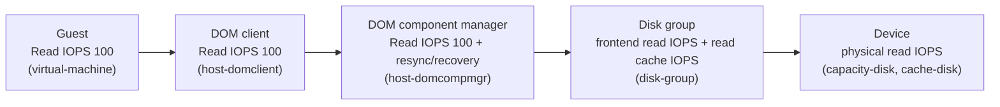

# Consumption Metrics

Companion to [01-formulas.md](01-formulas.md). Consumption metrics show how much work each layer does: IOPS, throughput and bandwidth, plus the CPU, memory and network resources that work uses. They say how busy something is, not how long IO waits (that is [02-contention.md](02-contention.md)). Space is in [04-capacity.md](04-capacity.md).

## 1. Consumption at each layer

The same workload appears at several layers with different numbers. Compare them to learn where the amplification happens.

| Layer | Frontend or backend | Typical entity | What it counts |
|---|---|---|---|
| Guest | Frontend | `virtual-machine`, `vscsi` | IOs the guest issues |
| DOM client | Frontend (vSAN view) | `host-domclient`, `cluster-domclient` | IOs the VM sends into vSAN |
| DOM component manager | Backend | `host-domcompmgr`, `cluster-domcompmgr` | IOs to components: replicas, resync, recovery, unmap |
| DOM owner | Backend | `host-domowner`, `cluster-domowner` | IOs the owner coordinates |
| Disk group (LSOM) | Backend, device-facing | `disk-group` | Frontend IO after LSOM, cache reads and writes, destage |
| Device | Physical | `capacity-disk`, `cache-disk` | IOs the drive serves |

For reads on a healthy mirror, the numbers stay close from the guest to the disk group. Writes multiply: each write goes to every replica, and the disk group writes it to the write buffer first and destages it later. Destage, which moves data from the cache tier to the capacity tier, shows as backend throughput (`ssdBytesDrained`) with no matching frontend IO.

## 2. Formulas

| Metric | Formula | Status |
|---|---|---|
| IOPS | completed IOs ÷ sample length (s) | Derived |
| Throughput | bytes moved ÷ sample length (s); VCPERF reports kBps | Derived; unit published |
| Average IO size | throughput ÷ IOPS | Derived |
| Backend-to-frontend ratio | backend IOPS (or throughput) ÷ frontend IOPS (or throughput) at the same time | Derived. Use it to measure amplification. For RAID-1 writes, expect about 2 |
| Read cache hit rate | hits ÷ (hits + misses) × 100 | Derived from the metric name (`rcHitRate`) |
| Destage rate | bytes destaged per second from the cache tier | Derived from `ssdBytesDrained` name; unit published |

## 3. Metrics by object type

### vSAN Cluster

| Metric | Entity → label | Unit | Meaning | Status |
|---|---|---|---|---|
| Read and write IOPS (VM side) | `cluster-domclient` → `iopsRead`, `iopsWrite` | IOPS | Client IOPS from all vSAN clients | Published by name |
| Read and write throughput (VM side) | `cluster-domclient` → `throughputRead`, `throughputWrite` | bytes/s | Client throughput | Published by name |
| Backend IOPS | `cluster-domcompmgr` → `iopsRead`, `iopsWrite`, `iopsResyncRead`, `iopsRecWrite` | IOPS | Backend IOPS including resync and recovery writes | Published by name (KB 326479 places this at the component manager) |
| Backend throughput | `cluster-domcompmgr` → `throughputRead`, `throughputWrite`, `tputResyncRead`, `throughputRecWrite` | bytes/s | Backend throughput by type | Published by name |
| Owner IOPS and throughput | `cluster-domowner` → `iopsRead`, `iopsWrite`, `iopsResyncRead`, `iopsRecWrite`, `tputRead`, `tputWrite`, `tputResyncRead`, `tputRecWrite` | IOPS, bytes/s | Owner-layer IO by type | Published by name |
| Resync and repair IO | `cluster-resync` → `iopsResyncReadPolicy`, `iopsResyncReadDecom`, `iopsResyncReadRebalance`, `iopsResyncReadFixComp`, and the write variants | IOPS | Background IO by reason: policy change, evacuation, rebalance, repair. Affects availability, so it is covered in [05-availability.md](05-availability.md) | Published by name |
| Resync throughput | `cluster-resync` → `tputResyncReadPolicy` … `tputResyncWriteFixComp` | bytes/s | Same, in bytes | Published by name |
| RDT socket throughput | `cluster-rdt-network-latency` → `rxSbSpaceAvg`, `txSbSpaceAvg` (min and max also) | bytes/s | Socket buffer throughput per direction | Published by name |
| Cluster capacity (for reference) | `vsan-cluster-capacity` → `total`, `used`, `free` | bytes | Capacity, not consumption. Listed here so the set is complete; see [04-capacity.md](04-capacity.md) | Published by name |

### vSAN Host

| Metric | Entity → label | Unit | Meaning | Status |
|---|---|---|---|---|
| Client IOPS | `host-domclient` → `iopsRead`, `iopsWrite`, `iopsUnmap` | IOPS | IOs from the VMs on this host | Published by name |
| Client throughput | `host-domclient` → `throughputRead`, `throughputWrite`, `throughputUnmap` | bytes/s | Client throughput | Published by name |
| Local client cache hits | `host-domclient` → `clientCacheHits` (Local Client Cache Hit IOPS), `clientCacheHitRate` (%) | IOPS, % | Reads served from the host's client cache | Published by name |
| Owner IOPS and throughput | `host-domowner` → `iopsRead`, `iopsWrite`, `tputRead`, `tputWrite`, `readLeafOwnerIops`, `writeLeafOwnerIops`, `readLeafOwnerThroughput`, `writeLeafOwnerThroughput` | IOPS, bytes/s | Owner IO, and the part served by leaf owners | Published by name |
| Backend IOPS | `host-domcompmgr` → `iopsRead`, `iopsWrite`, `iopsResyncRead`, `iopsRecWrite`, `iopsUnmap`, `iopsRecUnmap` | IOPS | Component-level IO | Published by name |
| Backend throughput | `host-domcompmgr` → `throughputRead`, `throughputWrite`, `tputResyncRead`, `throughputRecWrite`, `throughputUnmap`, `throughputRecUnmap` | bytes/s | Component-level throughput | Published by name |
| Snapshot-layer IO (vsanSparse) | `host-vsansparse` → `iopsRead`, `iopsWrite`, `iopsGwe`, `iopsRmw`, `iopsWriteConflicts`, `throughputRead`, `throughputWrite`, `cacheHitRate` | IOPS, bytes/s, number | IO through the vsanSparse snapshot layer, with its cache hit rate. GWE and RMW are named but not defined in the sources read | Published by name; definitions not published |
| Inbound and outbound network throughput | `vsan-host-net` → `rxThroughput`, `txThroughput` (Network Inbound and Outbound Throughput) | bytes/s | Traffic on the vSAN vmknic | Published by name |
| Packet rate | `vsan-host-net` → `rxPackets`, `txPackets`, `portRxpkts`, `portTxpkts` | packets/s, count | Packets on the vSAN vmknic and port | Published by name |
| cmmds network traffic | `cmmds-net` → `rdtRxThroughput`, `rdtTxThroughput`, `groupRxThroughput`, `groupTxUcastThroughput`, `groupTxMcastThroughput` | bytes/s | Cluster membership and directory traffic (CMMDS): RDT and group messages | Published by name |
| CPU used by vSAN | `vsan-cpu` → `usedPct` (Percentage of Used CPU Time), `runPct` (Running) | % | CPU time used by vSAN worlds | Published by name |
| CPU used by the physical host | `host-cpu` → `pcpuUsedPct` (Percentage of Used Physical CPU Time), `pcpuUtilPct`, `coreUtilPct` | % | Host CPU use | Published by name |
| Memory used | `system-mem` → `totalMbMemUsed` (Total Memory Used) | number | Memory used on the host | Published by name; unit as listed by the API |
| vSAN memory footprint | `vsan-memory` → `kernelReservedSize`, `uwReservedSize`, `clomdConsumedSize`, `cmmdsTimeMachineConsumedSize`, `vsanmgmtdConsumedSize`, … | number | Reserved and consumed memory per vSAN daemon | Published by name; unit not given by the API |
| Components on the host | `vsan-distribution` → `components`, `ioComponents`, `domClients`, `domOwners`, `domColocated` | number | Component and role counts per host | Published by name |

### Disk Group

| Metric | Entity → label | Unit | Meaning | Status |
|---|---|---|---|---|
| Frontend IOPS | `disk-group` → `iopsRead`, `iopsWrite` (Frontend Read and Write IOPS) | IOPS | IOs at the disk group, after LSOM aggregation | Published by name |
| Frontend throughput | `disk-group` → `throughputRead`, `throughputWrite` | bytes/s | Frontend throughput | Published by name |
| Read cache IOPS | `disk-group` → `iopsRcRead`, `iopsRcWrite` (Read Cache Read and Write IOPS) | IOPS | Reads and writes served by the read cache | Published by name. Hybrid only |
| Write buffer IOPS | `disk-group` → `iopsWbWrite`, `iopsWbRead` | IOPS | Writes and reads on the write buffer | Published by name. Hybrid only |
| Read cache hit rate | `disk-group` → `rcHitRate` (Read Cache Hit Rate) | % | Share of reads served from the read cache | Derived formula (see section 2). Hybrid only |
| Destage from the SSD | `disk-group` → `ssdBytesDrained` (Bytes De-stage from SSD) | bytes/s | Data moved from the cache tier to the capacity tier | Published by name |
| Zero-byte destage | `disk-group` → `zeroBytesDrained` (Zero-Bytes De-stage) | bytes/s | Zero-filled data destaged | Published by name |
| Scheduled and direct IOPS | `disk-group` → `iopsSched` (Total Delayed IOPS), `iopsDirectSched` (Direct Scheduled IOPS) | IOPS | IOPS through the scheduler, and the direct share | Published by name |
| Hashed bytes (dedup) | `disk-group` → `hashedBytes` (Hashed Bytes) | number | Bytes hashed for deduplication (OSA dedup) | *Not published* (name only) |

### vSAN Disk

| Metric | Entity → label | Unit | Meaning | Status |
|---|---|---|---|---|
| Physical IOPS | `capacity-disk` → `iopsDevRead`, `iopsDevWrite` (Physical-layer IOPS) | IOPS | IOs the capacity device serves | Published (KB 326812, "device-level read and write IOPS") |
| Physical throughput | `capacity-disk` → `throughputDevRead`, `throughputDevWrite` | bytes/s | Device-level throughput | Published (KB 326812) |
| vSAN-layer IOPS | `capacity-disk` → `iopsRead`, `iopsWrite` (vSAN Layer IOPS) | IOPS | IOs at the vSAN layer for the device | Published by name |
| vSAN-layer latency | `capacity-disk` → `latencyRead`, `latencyWrite` | ms | Latency at the vSAN layer for the device | Published by name |
| Cache device physical IOPS | `cache-disk` → `iopsDevRead`, `iopsDevWrite`, and throughput `throughputDevRead`, `throughputDevWrite` | IOPS, bytes/s | Physical-layer load on the cache device | Published by name |
| Read cache and write buffer IOPS (cache disk) | `cache-disk` → `iopsRcRead`, `iopsRcWrite`, `iopsWbRead`, `iopsWbWrite` | IOPS | Load on each part of the cache tier | Published by name. Hybrid only |
| Drained data (cache disk) | `cache-disk` → `plogTotalBytesDrained`, `plogSsdBytesDrained`, `plogZeroBytesDrained` (Total, SSD and Zero Drained) | bytes/s | Destage by type | Published by name |
| Read bytes by source (cache disk) | `cache-disk` → `plogTotalBytesRead`, `plogTotalBytesReadFromSSD`, `plogTotalBytesReadByRC`, `plogTotalBytesReadByVMFS` | bytes/s | Where reads were served from | Published by name |

ESA (`vsan-esa-disk-layer`, `vsan-esa-disk-scsifw`) has the ESA device counters. They were not returned on the reference cluster (OSA).

### vSAN Network Adapter

| Metric | Entity → label | Unit | Meaning | Status |
|---|---|---|---|---|
| vSAN vNIC throughput | `vsan-vnic-net` → `rxThroughput`, `txThroughput` (Throughput Inbound and Outbound) | bytes/s | Traffic on the vSAN vmknic | Published by name |
| vSAN vNIC packets | `vsan-vnic-net` → `rxPackets`, `txPackets` | packets/s | Packets on the vSAN vmknic | Published by name |
| Physical NIC throughput | `vsan-pnic-net` → `rxThroughput`, `txThroughput` (pNIC Throughput) | bytes/s | Traffic on the physical NIC | Published by name |
| Physical NIC packets | `vsan-pnic-net` → `rxPackets`, `txPackets`, `portRxpkts`, `portTxpkts` | packets/s, count | Packets on the NIC and its port | Published by name |

Compare the physical NIC throughput with the vNIC throughput. A gap between them is traffic that is not vSAN (other vmkernel services) or a port that carries more than vSAN.

### Virtual Machine

| Metric | Entity → label | Unit | Meaning | Status |
|---|---|---|---|---|
| Frontend IOPS | `virtual-machine` → `iopsRead`, `iopsWrite` | IOPS | The VM's IO | Published by name |
| Frontend throughput | `virtual-machine` → `throughputRead`, `throughputWrite` | bytes/s | The VM's throughput | Published by name |
| Read and write counts | `virtual-machine` → `readCount`, `writeCount` | count | Completed IOs over the sample | Published by name |
| Read and write IOPS (vCenter) | VCPERF `Virtual Machine` → `vsanDomObj.readIops.average`, `vsanDomObj.writeIops.average` | IOPS | Same as above, from vCenter counters | Published (API, VCPERF rows) |
| Read and write throughput (vCenter) | VCPERF `Virtual Machine` → `vsanDomObj.readThroughput.average`, `vsanDomObj.writeThroughput.average` | kBps | Throughput from vCenter counters | Published (API) |
| Recovery write IOPS and throughput (vCenter) | VCPERF `Virtual Machine` → `vsanDomObj.recoveryWriteIops.average`, `vsanDomObj.recoveryWriteThroughput.average` | IOPS, kBps | Recovery writes that the VM's objects generated | Published (API) |
| Cache hit rate (vCenter) | VCPERF `Virtual Machine` → `vsanDomObj.readCacheHitRate.latest` | % | Read cache hit rate for the VM | Published (API) |

Use the vCenter counters (VCPERF) for long-term charts and the performance service for detail. The vCenter counters are averages or latest values, not the per-sample figures the performance service returns.

### Virtual Disk

| Metric | Entity → label | Unit | Meaning | Status |
|---|---|---|---|---|
| Virtual disk IOPS | `vscsi` → `iopsRead`, `iopsWrite` | IOPS | IOs per virtual disk | Published by name |
| Virtual disk throughput | `vscsi` → `throughputRead`, `throughputWrite` | bytes/s | Throughput per virtual disk | Published by name |
| Normalised IOPS | `virtual-disk` → `NIOPS` (Normalized IOPS) | IOPS | IOPS after normalisation against the limit | Published by name |

### File Share, iSCSI Target and iSCSI LUN

These entities are in the API (`vsan-file-service`, `vsan-iscsi-target`, `vsan-iscsi-lun`) and were not returned on the reference cluster, because file service and iSCSI were not enabled there. Their metric names follow the same pattern: IOPS and throughput by direction. Check the labels in [metrics-api.md](../metrics-api.md) before using them. The file-share IOPS and throughput names (`readOpTotal`, `writeOpTotal`, `readTransferred`, `writeTransferred`) are listed there with their unit; no formula was found for them.

## 4. Reading consumption

- **Frontend vs backend.** The ratio of `cluster-domcompmgr` read IOPS to `cluster-domclient` read IOPS should be near 1. The write ratio should be near the number of replicas. A much higher ratio means resync or recovery traffic is included, or the object has more components than expected.
- **Destage.** A steady `ssdBytesDrained` with a rising `ssdCongestion` (see [02-contention.md](02-contention.md)) means the cache tier is draining at its limit.
- **Read cache.** On a hybrid cluster, `rcHitRate` below the working-set size points to too little cache for the workload. Derived formula only; no Broadcom threshold was found.
- **Network.** Compare `vsan-host-net` throughput with `vsan-pnic-net` throughput. Packet rates matter at small IO sizes; throughput matters at large ones.
- **Background IO.** Resync, recovery and rebalance IO take bandwidth from the client. Their metrics are listed here and explained in [05-availability.md](05-availability.md).
