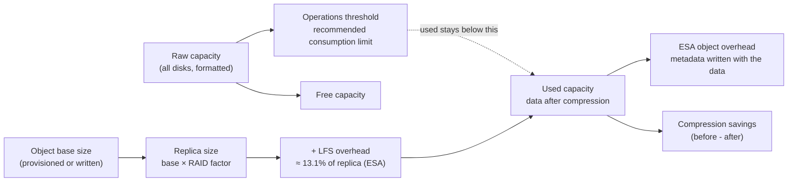

# Capacity Metrics

Companion to [01-formulas.md](01-formulas.md). Capacity metrics describe space: how much is provisioned, used, free, reserved, lost to overhead, and saved by dedup and compression. They are kept apart from consumption (IOPS, throughput) in [03-consumption.md](03-consumption.md), as the request asked. Most capacity values come from the vSAN management API (VSAN source), not the performance service, so the field paths are in the tables.

## 1. Capacity model

Space moves through these stages. Each stage has a metric, and the difference between two stages is a loss or a saving.

Read the diagram top to bottom for the cluster and right to left for one object: an object's size grows from its base, through its replicas, to its on-disk footprint.

## 2. Formulas

| Quantity | Formula | Status | Source |
|---|---|---|---|
| Object replica size | base size × RAID factor. RAID-1 adds a full copy; RAID-5 adds 25% of the primary copy; RAID-5 (2+1) and RAID-6 add 50%, as stated in the source | Published | KB 394410 |
| LFS overhead | ≈ 13.1% of the replica size | Published | KB 394410 |
| Total object footprint | replica size + LFS overhead | Published | KB 394410 |
| Worked example | 10 GB thin RAID-1 object: 20 GB replicas + 2.62 GB overhead = 22.62 GB | Published example | KB 394410 |
| ESA object overhead, as a share of stored data | the report shows about 11.96% of stored data in the example | Published example, not a rule | VMware blog, *Improved Capacity Reporting* (2024) |
| Used capacity | data written after compression, excluding free capacity | Published (usage breakdown) | same blog |
| Compression savings | data before compression − data after compression | Published (definition by example) | same blog |
| Used + savings | ≈ data and metadata before compression | Inferred from the blog's example figures (17.69 TB + 13.70 TB ≈ 31 TB). Not a stated formula | same blog |
| Dedup ratio (`dedupRatio`) | space before dedup ÷ space after dedup | Published | vSAN Management API, `VsanSpaceEfficiencyRatio` |
| Compression ratio | space before compression ÷ space after compression | Published | same reference |
| ESA overall ratio | like dedup and compression, but the ESA overall ratio excludes all system overhead | Published | same reference |
| ESA global dedup ratio (`dedupEnabledRatio`) | dedup ratio of only the objects eligible for ESA global dedup | Published | same reference |
| Thin provision ratio, snapshot saving ratio | names only | *Not published* | none found |

Key figures for a sizing exercise: the replica factor (RAID and FTT), the overhead (about 13% of the replica on ESA, per KB 394410), and the compression ratio observed on real data.

## 3. Thresholds

| Threshold | Where | Values | Status |
|---|---|---|---|
| Capacity health threshold, yellow and red | `VsanQuerySpaceUsage` → `capacityHealthThreshold.yellowValue`, `redValue` (vSAN Cluster) | long, unit not stated by the API | Published as fields; the unit and the default values are not in the sources read |
| Operations threshold | Blog, *Improved Capacity Reporting*: "a recommended capacity consumption limit" that gives vSAN room for operations | Example: 38.27 TB of 46.57 TB raw | Published concept, example value only |
| Disk free-space health | `limitHealth.hostResults[].lowestFreeDiskSpacePct` (vSAN Cluster) | % | Published field |
| Disk space threshold (what-if) | `limitHealth.whatifHostFailures[].diskSpaceThreshold` (yellow, red, target) | values | Published fields |

The thresholds in the health summary decide the yellow and red capacity health checks. Check the thresholds on your cluster before comparing a percentage with a colour in the UI.

## 4. Metrics by object type

### vSAN Cluster

| Metric | Source → field | Unit | Meaning | Status |
|---|---|---|---|---|
| Total capacity | `vsan-cluster-capacity` → `total` | bytes | Formatted raw capacity of the cluster | Published by name |
| Free capacity | `vsan-cluster-capacity` → `free` | bytes | Free space | Published by name |
| Used capacity | `vsan-cluster-capacity` → `used` | bytes | Used space | Published by name |
| Saved by dedup | `vsan-cluster-capacity` → `savedByDedup` | bytes | Space saved by deduplication | Published by name |
| Space efficiency ratio | `vsan-cluster-capacity` → `dedupRatio` | ratio (API says %) | Dedup and compression ratio | Published formula (section 2). Unit label in the API is `%`, but the value is a ratio |
| Space overview | `VsanQuerySpaceUsage` → `spaceOverview` (Used, Free, Physical Used, Overhead, Over Reserved, Provision, Reserved, Primary, Snapshot Used, Temporary Overhead) | bytes | Cluster space by role | Published by name |
| Uncommitted | `VsanQuerySpaceUsage` → `spaceOverview` (Uncommitted) | bytes | Provisioned space not yet written | Published by name |
| What-if capacity | `VsanQuerySpaceUsage` → `whatifCapacities[]` (is satisfiable, free and total what-if) | bytes, boolean | Whether the cluster can absorb a host failure, by the vSAN calculation | Published by name; the calculation not published |
| Space usage by object type | `VsanQuerySpaceUsage` → `spaceDetail.spaceUsageByObjectType[]` (`objType`, `objTypeExt`) | bytes | Used space by object type (VM home, VMDK, swap, snapshot and so on) | Published by name |
| Host capacity | `VsanQueryVcClusterHealthSummary` → `limitHealth.hostResults[].totalDiskSpaceB`, `usedDiskSpaceB`, `totalLogicalSpaceB`; and `lowestFreeDiskSpacePct` (%) | bytes, % | Per-host space and the lowest free share | Published by name |
| Disk health capacity | `VsanQueryVcClusterHealthSummary` → `encryptionHealth.hostResults[].diskResults[].diskHealth` → `totalBytes`, `usedCapacity`, `freeBytes`, `capacity` | bytes (`capacity` is a number) | Per-disk space health | Published by name |

### vSAN Datastore

These fields come from `VsanQuerySpaceUsage` and the datastore properties. They describe the vSAN datastore the cluster presents.

| Metric | Field | Unit | Meaning | Status |
|---|---|---|---|---|
| Logical capacity | `Logical Capacity`, `Logical Capacity Used` | bytes | Capacity before dedup and compression | Published by name |
| Physical capacity | `Physical Capacity`, `Physical Capacity Used` | bytes | Capacity on disk after dedup and compression | Published by name |
| Actual written | `Actual Written` | bytes | Data actually written | Published by name |
| Compression ratio | `Compression Ratio` | ratio | Compression ratio (section 2) | Published formula |
| Space efficiency ratio | `Space Efficiency Ratio: Overall Ratio` | ratio | Overall ratio, ESA excludes system overhead | Published formula |
| Snapshot saving ratio | `Snapshot Saving Ratio` | ratio | Space saved by snapshots | *Not published* (name only) |
| Thin provision ratio | `Thin Provision Ratio` | ratio | Provisioned ÷ used, by name | *Not published* (name only) |
| ESA compression saving | `Esa Compression Space Saving`, `Compression Metadata Size` | bytes | Space saved by ESA compression, and the metadata it needs | Published by name |
| Effective space usage | `Effective Space Usage: Free Usable`, `Total Usable`, `Over Reserved` | bytes | Usable space for VMs | Published by name |
| Space usage by role | `Space Usage By Object Type: Used`, `Physical Used`, `Overhead`, `Over Reserved`, `Snapshot Used`; `Temporary Overhead` | bytes | Space by role | Published by name |
| Snapshot space | `Actual Snapshot Used`, `Fully Inflated Snapshot Used`, `Snapshot Space: Snapshot Count` | bytes, count | Snapshot footprint | Published by name |
| Total space used without overhead | `Total Space Used Without Overhead` | count | Used space excluding overhead | Published by name; unit as listed by the API |
| What-if capacity | `Free Whatif Capacity`, `Total Whatif Capacity` | bytes | What-if view for a host failure | Published by name |

### vSAN Object

Per object, from `VsanQueryObjectIdentities` → `spaceSummary[]`. Use these to find which object takes the space.

| Metric | Field | Unit | Meaning | Status |
|---|---|---|---|---|
| Used | `spaceSummary[].usedB` | bytes | Space used by the object | Published by name |
| Physical used | `spaceSummary[].physicalUsedB` | bytes | Physical space the object takes, including replicas | Published by name |
| Overhead | `spaceSummary[].overheadB` | bytes | Overhead written with the object (LFS) | Published (KB 394410 overhead model) |
| Temporary overhead | `spaceSummary[].temporaryOverheadB` | bytes | Temporary overhead, such as during a resync | Published by name |
| Over-reserved | `spaceSummary[].overReservedB` | bytes | Space reserved beyond use | Published by name |
| Snapshot used | `spaceSummary[].snapshotUsedB` | bytes | Space used by snapshots of the object | Published by name |
| Primary capacity | `spaceSummary[].primaryCapacityB` | bytes | Primary (base) capacity of the object | Published by name |
| Provision capacity | `spaceSummary[].provisionCapacityB` | bytes | Provisioned capacity | Published by name |
| Reserved capacity | `spaceSummary[].reservedCapacityB` | bytes | Reserved capacity (thick provisioning) | Published by name |

Apply the KB 394410 formula to these fields: for a thick object, the reserved capacity and the overhead are both known at creation; for a thin object, the used capacity grows with the data written.

### Disk Group (OSA)

| Metric | Entity → label | Unit | Meaning | Status |
|---|---|---|---|---|
| Capacity | `disk-group` → `capacity` | bytes | Capacity of the disk group | Published by name |
| Used capacity | `disk-group` → `capacityUsed` | bytes | Used | Published by name |
| Reserved capacity | `disk-group` → `capacityReserved` | bytes | Reserved | Published by name |
| Read cache and write buffer size | `disk-group` → `rcSize`, `wbSize` | bytes | Hybrid cache sizes | Published by name. Hybrid only |
| Space efficiency bytes | `disk-group` → `dedupedBytes` (Space Efficiency Bytes) | number | Bytes saved by dedup in the disk group | Published by name |
| Space efficiency capacity | `disk-group` → `ddpTotalCap` (Space Efficiency Total Capacity), `ddpFreeCap` (Space Efficiency Free Capacity) | number | Dedup capacity and its free share | Published by name |
| Compression percentage | `disk-group` → `compressPct` (Compress Percentage) | number | Compression share | Published by name; formula not stated |
| Dedup percentage | `disk-group` → `dedupPct` (Dedup Percentage) | number | Dedup share | Published by name; formula not stated |

### vSAN Disk

| Metric | Entity → label | Unit | Meaning | Status |
|---|---|---|---|---|
| Used capacity | `capacity-disk` → `capacityUsed` (Used Capacity) | number | Used space on the capacity device | Published by name |
| Physical capacity (capacity tier) | `capacity-disk` → `phyCapUsed`, `phyCapRsrvd`, `phyCapRsrvdUsed`, `phyCapT2`, `phyCapCF` | number | Physical used, reserved, and the tier-2 and CF shares | Published by name |
| Logical capacity (capacity tier) | `capacity-disk` → `lgclCapUsed`, `lgclCapReserved`, `lgclCapUnrsvrd`, `lgclCapUnmap`, `lgclCapFsMetadata`, `lgclCapConsUsage`, `lgclCapConsPrep` | number | Logical used, reserved, unreserved, unmapped, file-system metadata, and consumption states | Published by name |
| Capacity compressed | `capacity-disk` → `capacityCompressed` | number | Compressed capacity | Published by name |
| Disk fullness | `capacity-disk` → `currentDiskFullness`, `expectedDiskFullness` | number | Fullness now and expected | Published by name |
| Used capacity (cache disk) | `cache-disk` → `lgclCapUsed`, `phyCapUsed`, `phyCapRsrvd`, `phyCapT2`, `phyCapCF` | number | Cache-tier logical and physical space | Published by name |
| Cache tier log and data space | `cache-disk` → `llogLog`, `llogData`, `plogLog`, `plogData` | number | Log and data space in the cache tier | Published by name |

### Virtual Machine and Virtual Disk

The performance service does not report VM space. For VM space, use the object and datastore fields above, or the `Used Capacity` of the VM home and disk objects. The `Virtual Disk` rows in [metrics-api.md](../metrics-api.md) cover IO, not space.

## 5. Reading capacity

- **Start at the datastore.** Use `Logical Capacity Used` and `Physical Capacity Used` to see what the data takes before and after reduction. The difference is the reduction you are getting.
- **Check the overhead.** On ESA, `overheadB` and the ESA object overhead are the cost of the LFS layout. A few percent of the data is normal; a much higher share suggests small objects or many snapshots.
- **Compare the ratios with the data.** A dedup or compression ratio applies to the data that can be reduced. Encrypted or already compressed data gives a ratio near 1.0.
- **Use the what-if fields** to check the cluster can take a host failure before you change the policy or add VMs.
- **Keep the units straight.** `dedupRatio` is a ratio even though the API labels it `%`. Capacity thresholds are in the health summary, not in the performance service.
