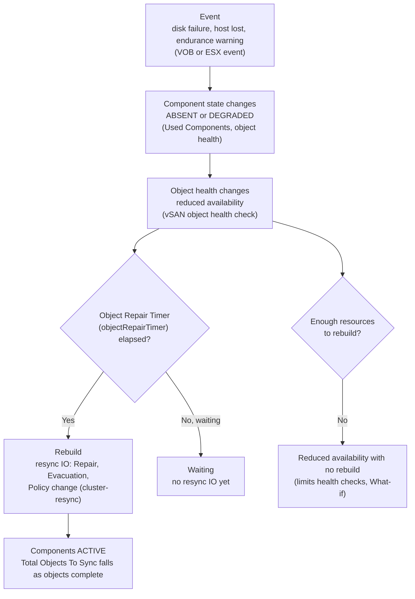

# Availability Metrics and Events

Companion to [01-formulas.md](01-formulas.md). Availability is driven by events, not by a steady stream. A disk fails, a host drops out, an SSD wears down, and the cluster reacts: components go absent, objects lose a copy, resync jobs rebuild the data, and health checks change colour. This file lists the events, the health checks, and the metrics that show each step, grouped by object type.

Availability metrics are mostly state and counts, not rates. Read them as "how many objects, components or jobs are in this state now" rather than as a per-second value.

## 1. What happens when a component fails

Three layers show the same event:

1. **Events** tell you when something happened: an ESX VOB or a health alarm.
2. **Health checks** tell you what the cluster thinks is wrong, and which test caught it.
3. **Metrics** tell you how big the impact is: how many components, objects and bytes are affected, and how far the rebuild has got.

## 2. Events

Events are the first signal. The table gives the event ID, the severity, and the source. The ID is what goes into a vCenter alarm or a log search.

| Event ID | Severity | Meaning | Source | Status |
|---|---|---|---|---|
| `esx.problem.vob.vsan.lsom.diskerror` | Error | A vSAN device is under permanent failure | Broadcom vSAN 8.0 VOB table (search summary) | Name and description from the search summary. Check against `vobd.log` on your host |
| `esx.problem.vob.vsan.pdl.offline` | Not verified | Permanent device loss on the device path. Broadcom's device-failure guidance pairs it with `diskerror` | Broadcom device-failure guidance (search summary) | Name only |
| `esx.problem.vob.vsan.lsom.devicerepair` | Not verified | A device is offline and being repaired | Broadcom KB (search summary) | Name only |
| `esx.problem.vsan.health.ssd.endurance.warning` | Warning | An NVMe device reached **90%** of its estimated endurance (ESA, vSphere 8.0 U2 and later) | KB 326721 | Published |
| `esx.problem.vsan.health.ssd.endurance.error` | Critical | An NVMe device reached **100%** of its estimated endurance | KB 326721 | Published |
| `esx.problem.vsan.health.ssd.endurance` | Info | A disk passed its warning usage level. Thresholds are customisable (vSphere 8.0 U3 and later) | KB 326721 | Published |

Endurance and wear, in detail:

- The alarm is **vSAN Health Alarm for disk endurance check**. You set its rule in **Configuration → Alarm Definitions**, scoped by cluster, host, disk name or disk vendor name (KB 326721).
- Broadcom runs the endurance scan **every 12 hours** (KB 326721).
- The scope in KB 326721 is **NVMe devices in ESA clusters**. The sources read did not show an equivalent wear alarm for OSA SSDs or for vSAN 9. Check the SMART wear value of an OSA SSD with the host tools in the next paragraph.
- Remediation (KB 326721): if a spare NVMe is available, claim it into the ESA storage pool and then evacuate the failing disk. If not, ask the hardware vendor for a replacement.
- Raw wear: the SMART `Media Wearout Indicator` shows remaining life. The Dell-hosted VMware guide shows the host command `localcli storage core device smart get -d <naa>` for it. KB 387178 says there is no fixed percentage that guarantees normal operation. Single-digit remaining wear should be watched closely and, with vendor approval, replaced early.

Disk and host failure, operational notes:

- Disks in evacuation show as **Evacuating** and then **Evacuated** in the disk health status (KB 395966, title only). The Skyline Health view under the cluster's **Physical disk** section raises the impending-failure alerts.
- A vCenter alarm tied to `diskerror` may not clear on its own. Clear it by hand after the device is replaced (search summary, third-party alarm reference).
- vSAN's dying-disk handling marks a disk as unhealthy and can start evacuation before it fails (Dell-hosted guide).

## 3. Component and object states

Each component of an object has a state. The API enumerates these names (`vim.cluster.VsanComponentStates`):

| State | Meaning | Source |
|---|---|---|
| `ACTIVE` | Normal state | Name |
| `ACTIVE_STALE` | "A component that is in a normal state but is out of sync with the cluster" | Broadcom API reference (search summary) |
| `ABSENT` | Component not available | Name |
| `ABSENT_RESYNC` | Absent, with resync involved | Name |
| `DEGRADED` | "A component that is in a degraded state" | Broadcom API reference (search summary) |
| `RECONFIG` | Component being reconfigured | Name |
| `UNKNOWN` | State not known | Name |

The object's health label summarises these states. Broadcom's health documentation (search summary of KB 326929, *vSAN Health Service - Data Health - vSAN Object Health*) describes *reduced availability* as: the object has taken a failure it was built to tolerate, so I/O continues and the object stays accessible, but vSAN is not re-protecting it.

**Reduced availability with no rebuild** is the state to act on. The object has taken a failure it can tolerate, so IO continues, but vSAN is not re-protecting it. Causes seen in Broadcom KBs:

- **A host in maintenance mode still owns the object** (KB 416613). The rebuild does not start, even with *Repair objects immediately*.
- **Concatenated components cannot be merged** because the disks lack free space (KB 413125). Components stay in `ABSENT` or `DEGRADED`.
- **The policy is no longer satisfiable** after the cluster shrinks: for example RAID-6 kept after the cluster falls below six hosts (KB 400420).

Check it with the host CLI. `esxcli vsan debug object health summary get` gives a cluster count by health. `esxcli vsan debug object list --health=reduced-availability-with-no-rebuild` lists the affected objects and their owners, and the object list output shows each component's state (KB 400420 and KB 413125 search summaries). Start with the *Limits* health checks in section 4 to see whether capacity or component limits are the cause.

## 4. Health checks

The health summary is the third layer. The repo's catalog lists 191 health checks in 19 groups. The checks that matter for availability are below, with the API `testId` and the name the API returns. Every check in this table returned *not run* on the reference cluster, which means it did not appear in the cluster's health summary. That is not a pass. It means the test has not reported on this cluster, so its state is unknown there.

| Group | `testId` | Check name (API) | Reference cluster |
|---|---|---|---|
| Data | `objecthealth` | vSAN object health | not run |
| Data | `objectstore` | Object store health | not run |
| Data | `objectformat` | vSAN object format health | not run |
| Data | `objpolicy` | vSAN object policy health | not run |
| Physical disk | `physdiskoverall` | Operation health | not run |
| Physical disk | `physdiskcongestion` | Congestion | not run |
| Physical disk | `physdiskhostissues` | Physical disk health retrieval issues | not run |
| Physical disk | `phmhealth` | Vendor Reported Drive Health | not run |
| Physical disk | `componentmetadata` | Component metadata health | not run |
| Physical disk | `physdiskcapacity` | Disk capacity | not run |
| Physical disk | `physdiskcomplimithealth` | Physical disk component utilization | not run |
| Physical disk | `lsomslab` | Memory pools (slabs) | not run |
| Physical disk | `lsomheap` | Memory pools (heaps) | not run |
| Physical disk | `smalldiskstest` | vSAN maximum component size | not run |
| Physical disk | `diskusage` | Disks usage on storage controller | not run |
| Physical disk | `licenseddisks` | Disk licensed capacity consistency | not run |
| Cluster | `resynclimit` | Resync operations throttling | not run |
| Limits | `limit1hf` | What if the most consumed host fails | not run |
| Limits | `nodecomponentlimit` | Cluster and host component utilization | not run |
| Limits | `diskspace` | Storage space | not run |
| Limits | `rcreservation` | Read cache reservations | not run |
| File Service | `sharehealth`, `fileserver` | Share Health, File Server Health | Not on the reference cluster |
| iSCSI | `iscsilunruntimetest`, `iscsiservicerunningtest`, `iscsihomeobjectstatustest` | LUN runtime health, Service runtime status, Home object | Not on the reference cluster |

Reading the group "Online health" (`cloudhealth`) and the group `ssdendurance`: the group `ssdendurance` holds one test whose API name is `clusternotfound`. It is not an endurance check. The endurance signal is the alarm and the events in section 2, not a health check.

The 10 checks listed in both the local group and the online group are the same test ID. Count each one once. The repo's [comparison.md](../comparison.md) lists the pairs.

## 5. Metrics by object type

Each row names the entity or field it comes from. Live means the value came back on the reference cluster.

### vSAN Cluster

| Metric | Source → field or entity → label | Unit | Meaning | Live |
|---|---|---|---|---|
| Health score | `VsanQueryVcClusterHealthSummary` → `healthScore` | number | Cluster health score. The formula is not published | ✓ |
| Test healthy entities | `VsanQueryVcClusterHealthSummary` → `groups[].groupTests[].testHealthyEntities` | number | Entities that passed a test | ✓ |
| Test all entities | `VsanQueryVcClusterHealthSummary` → `groups[].groupTests[].testAllEntities` | number | Entities a test covered | ✓ |
| Health status counts | `VsanQueryVcClusterHealthSummary` → `healthStatusCounts.error`, `.warning`, `.info` | number | Counts of checks in each status | Schema only |
| Total objects to sync | `QuerySyncingVsanObjectsSummary` → `totalObjectsToSync` | count | Objects waiting for a sync (rebuild or move) | ✓ |
| Total bytes to sync | `QuerySyncingVsanObjectsSummary` → `totalBytesToSync` | count | Bytes left to sync | ✓ |
| Active objects to sync | `QuerySyncingVsanObjectsSummary` → `syncingObjectRecoveryDetails.activeObjectsToSync` | count | Objects being synced now | ✓ |
| Total recovery ETA | `QuerySyncingVsanObjectsSummary` → `totalRecoveryETA` | s | Estimated time to finish the sync | ✓ |
| Object repair timer | `VsanClusterGetConfig` → `extendedConfig.objectRepairTimer` | number | Delay before a rebuild starts after a component is lost | ✓ |
| Host failures to tolerate | `VsanGetClusterRAIDInfo` → `hostFailuresToTolerate` | number | FTT for the cluster | Schema only |
| What-if host failures | `VsanQueryVcClusterHealthSummary` → `limitHealth.whatifHostFailures[].numFailures`, `.usedComponents` | count | Failures the cluster can absorb, and the components in use | ✓ |
| Resync and recovery jobs | `cluster-domowner` → `numPendingResyncJobs`, `numRunningResyncJobs`, `numSuspendedResyncJobs`, `numCompleteResyncOps` | count | Resync jobs by state | ✓ (performance) |
| Resync job types | `cluster-domowner` → `numCompleteFullResyncOps`, `numCompleteDeltaToBaseResyncOps`, `numCompleteSiblingToDeltaResyncOps`, `numCompleteRwrOps` | count | Completed resync ops by type | ✓ |
| Owner and component-manager pressure | `cluster-domowner` and `cluster-domcompmgr` → `congestion`, `oio` (see [02-contention.md](02-contention.md)) | number | Congestion and in-flight IO while resync runs | ✓ |
| Resync IO by reason | `cluster-resync` → `iopsResyncReadFixComp` (Repair Read), `iopsResyncReadDecom` (Evacuation Read), `iopsResyncReadRebalance` (Rebalance Read), `iopsResyncReadPolicy` (Policy Change Read), and the write variants | IOPS | Background IO by reason | ✓ |
| Resync latency by reason | `cluster-resync` → `latResyncReadFixComp`, `latResyncReadDecom`, … and write variants | ms | Latency of background IO by reason | ✓ |
| Disk balance | `VsanQueryVcClusterHealthSummary` → `diskBalance.disks[].fullness`, `fullnessAboveThreshold`; `diskBalance.varianceThreshold` | number | Disk fullness, and the threshold it is compared with | ✓ |
| Clomd liveness | `VsanQueryVcClusterHealthSummary` → `clomdLiveness.issueFound`, `clomdLivenessResult[].clomdStat` | boolean, string | Whether the component manager daemon (CLOM) is alive on each host | ✓ |
| Cluster status | `VsanQueryVcClusterHealthSummary` → `clusterStatus.status`, `goalState`, `trackedHostsStatus[].status` | string | Overall cluster state and per-host state | ✓ |

### vSAN Object

| Metric | Source → field | Unit | Meaning | Live |
|---|---|---|---|---|
| Object health detail | `VsanQueryObjectIdentities` → `health.objectHealthDetail[].numObjects` | count | Objects by health state | ✓ |
| Objects by policy | `VsanQueryObjectIdentities` → `health.objectStats.numAutoManagedObjects`, `numFTT3ManagedObjects` | count | Objects managed by policy, including FTT=3 | ✓ |
| Operation progress | `VsanQueryObjectIdentities` → `health.objectsComplianceDetail[].operationalStatus.operationProgress` | number | Progress of a policy change or reconfiguration | Schema only |
| Objects relayout bytes | `VsanQueryObjectIdentities` → `health.objectsRelayoutBytes` | bytes | Bytes to move to comply with the policy | ✓ |
| Components to sync | `QuerySyncingVsanObjectsSummary` → `objects[].components[].bytesToSync`, `recoveryETA` | count, s | Per-object sync progress | Schema only |

### vSAN Host

| Metric | Entity → label or field | Unit | Meaning | Live |
|---|---|---|---|---|
| Components on the host | `vsan-distribution` → `components`, `ioComponents`, `domOwners`, `domClients`, `domColocated` | number | Components and roles on this host | ✓ |
| Planned and unplanned delta components | `vsan-distribution` → `plannedDeltaComponents`, `unplannedDeltaComponents` | number | Delta components (snapshot-related) by planned or unplanned creation | ✓ |
| Peer health latency | `VsanQueryVcClusterHealthSummary` → `networkHealth.hostResults[].peerHealth[].maxLatencyUs` | µs | Maximum latency to peer hosts | ✓ |
| Peer ping success | `VsanQueryVcClusterHealthSummary` → `networkHealth.hostResults[].peerHealth[].largePingTestSuccessPct` | % | Large-packet ping success to peers | ✓ |
| vMotion ping success | `VsanQueryVcClusterHealthSummary` → `networkHealth.hostResults[].vMotionHealth[].largePingTestSuccessPct` | % | Same for vMotion peers | ✓ |
| Missing heartbeats | `VsanQueryVcClusterHealthSummary` → `networkHealth.hostResults[].peerHealth[].missingHeartBeatCount` | count | Heartbeats missing from a peer | Schema only |
| External peer missing heartbeats | `VsanQueryVcClusterHealthSummary` → `networkHealth.hostResults[].externalPeerHealth[].missingHeartBeatCount` | count | Same for external peers | Schema only |
| Small ping success | `VsanQueryVcClusterHealthSummary` → `networkHealth.hostResults[].peerHealth[].smallPingTestSuccessPct` | % | Small-packet ping success | ✓ (peer path; other paths are schema only) |
| Host CLOM and CMMDS memory | `vsan-memory` → `clomdConsumedSize`, `cmmdsdConsumedSize`, `cmmdsTimeMachineConsumedSize` | number | Memory of the daemons that manage availability | ✓ (unit not given) |

Ping and heartbeat results tell you whether a host is reachable on the vSAN network before the data path shows it. A missing heartbeat on one host, with clean ping results on the others, points at that host's vmknic or port.

### vSAN Disk

| Metric | Source → field or entity → label | Unit | Meaning | Live |
|---|---|---|---|---|
| Used components on the disk | `VsanQueryVcClusterHealthSummary` → `physicalDisksHealth[].disks[].usedComponents` | count | Components on the disk. A disk with zero components after an evacuation is ready to remove | ✓ |
| Remaining bytes to move | `VsanQueryVcClusterHealthSummary` → `physicalDisksHealth[].disks[].rebalanceResult.remainingBytesToMove` | bytes | Data still to move off or onto the disk | ✓ |
| Components to flush | `capacity-disk` → `commitFlusherComponentsToFlush` | count | Components waiting for a flush (verbose mode only) | Verbose only |
| Disk health max components | `VsanQueryVcClusterHealthSummary` → `encryptionHealth.hostResults[].diskResults[].diskHealth.maxComponents` | count | Component limit of the disk | ✓ |
| Disk health used components | `VsanQueryVcClusterHealthSummary` → `encryptionHealth.hostResults[].diskResults[].diskHealth.usedComponents` | count | Components in use on the disk | ✓ |
| Rebalance result | `VsanQueryVcClusterHealthSummary` → `encryptionHealth.hostResults[].diskResults[].diskHealth.rebalanceResult` | various | Disk-level rebalance state | ✓ |
| Endurance (NVMe, ESA) | VOB events in section 2 | not a metric | Warning and critical endurance events | See events |

### Disk Group

| Metric | Entity → label | Unit | Meaning | Live |
|---|---|---|---|---|
| Resync latency | `disk-group` → `latResyncRead`, `latResyncWrite` (Resync Read and Write Latency) | ms | Latency of resync IO at the disk group | ✓ |
| Resync IOPS and throughput | `disk-group` → `iopsResyncRead`, `iopsResyncWrite`, `tputResyncRead`, `tputResyncWrite` | IOPS, bytes/s | Resync IO at the disk group | ✓ |
| Resync by reason | `disk-group` → `iopsResyncReadFixComp` (Repair), `iopsResyncReadDecom` (Evacuation), `iopsResyncReadRebalance` (Rebalance), `iopsResyncReadPolicy` (Policy Change) and the write variants | IOPS | Background IO by reason at the disk group | ✓ |
| Bytes to sync (current) | `disk-group` → `curBytesToSyncFixComp`, `curBytesToSyncDecom`, `curBytesToSyncRebalance`, `curBytesToSyncPolicy`, `curBytesToSyncRepair` | bytes | Bytes still to sync at the disk group, by reason | ✓ (where returned); name only for the formula |

### Virtual Machine and Virtual Disk

| Metric | Source → field | Unit | Meaning | Live |
|---|---|---|---|---|
| Recovery write congestion | VCPERF `Virtual Machine` → `vsanDomObj.recoveryWriteCongestion.average` | number | Congestion from rebuild writes the VM's objects generate | ✓ (VCPERF) |
| Recovery write IOPS and throughput | VCPERF `Virtual Machine` → `vsanDomObj.recoveryWriteIops.average`, `vsanDomObj.recoveryWriteThroughput.average` | IOPS, kBps | Rebuild writes the VM's objects generate | ✓ (VCPERF) |

A VM has no availability state of its own in the performance service. Its availability shows in its object health (vSAN Object) and in the resync counts above.

### File Share, iSCSI Target and iSCSI LUN

| Metric | Source → field | Unit | Meaning | Live |
|---|---|---|---|---|
| File share object health | `VsanQueryVcClusterHealthSummary` → `fileServiceHealth.hostResults[].fileShareHealth[].objectHealth.objectHealthDetail[].numObjects` | count | Objects per file share by health state | Not on the reference cluster |
| File server SMB connections | `VsanQueryVcClusterHealthSummary` → `fileServiceHealth.hostResults[].fileServerHealth[].smbConnections` | number | Client connections to the file server | Not on the reference cluster |
| iSCSI and file-service entities | `vsan-iscsi-target`, `vsan-iscsi-lun`, `vsan-file-service` | various | Performance entities for these services | Not on the reference cluster |

## 6. Caveats for the reference data

- **Physical-disk and data health checks are not verified.** All 17 checks in the *Physical disk* and *Data* groups returned *not run* on the reference cluster. Their state cannot be read from that run. Use the events in section 2 and the metrics in section 5 until a run confirms the checks on your cluster.
- **Endurance is an event, not a health check.** The `ssdendurance` group holds a test named `clusternotfound`. Do not read it as an endurance result.
- **ESA-only availability** (NVMe endurance, ESA components) was not on the reference cluster, which is OSA.
- **Health score.** The formula is not published, so do not compute a score from the status counts.
