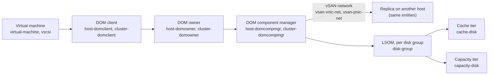

# vSAN Performance and Availability: Level 400 Reference

This folder explains how to read the vSAN metrics catalogued in [metrics-api.md](../metrics-api.md) and [properties-api.md](../properties-api.md) for VCF 9.1: what each family measures, how it is calculated where Broadcom publishes the calculation, and what it means when it moves.

## Contents

| File | Covers |
|---|---|
| [01-formulas.md](01-formulas.md) | How metrics are sampled and rolled up, the formulas that are published, the relationships between metrics, and what is not published |
| [02-contention.md](02-contention.md) | Queues, congestion, outstanding IO, latency, dropped packets and CPU ready, grouped by object type |
| [03-consumption.md](03-consumption.md) | IOPS, throughput, bandwidth and resource use, grouped by object type. Capacity is in 04 |
| [04-capacity.md](04-capacity.md) | Space metrics (total, used, free, overhead, savings, ratios) and the capacity formulas |
| [05-availability.md](05-availability.md) | Availability metrics, health checks and events: disk failure, endurance, component states, resync |

## How the metrics fit together

The same IO is measured at several layers. A VM write leaves the guest as a *frontend* IO, becomes *backend* IO on each replica, and reaches a disk group through LSOM. Each layer has its own metric entity. The diagram shows the entities in the performance service that match each layer.

Read the diagram from left to right for the IO path. Compare an upper layer with the layer below it to see where time or throughput is lost: frontend IOPS vs backend IOPS shows RAID amplification, and frontend latency vs disk-group latency shows queueing below the VM.

## Three kinds of statements in these docs

- **Published**: Broadcom documents the calculation or definition. The source is named next to it.
- **Derived**: a formula that follows from the metric's definition or from general queueing and arithmetic rules. It is labelled *derived* and is not a Broadcom statement.
- **Not published**: no formula found in the Broadcom documents or the public sources searched. These are described by name only.

## Live coverage on the reference cluster

The repo's live check ran on one VCF 9.1.1 OSA cluster with 3 hosts, performance service on, verbose mode off, no deduplication, encryption, file service, iSCSI or stretched cluster. Metric entities that returned values there are shown below. Entities that did not return values are not wrong, they belong to features that were not enabled. See [raw/live.json](../raw/live.json) for the field paths.

| Entities with values on the reference cluster | Entities without values (feature or mode not enabled) |
|---|---|
| `cluster-domclient`, `cluster-domcompmgr`, `cluster-domowner`, `cluster-resync`, `cluster-rdt-network-latency`, `vsan-cluster-capacity`, `host-domclient`, `host-domowner`, `host-domcompmgr`, `host-vsansparse`, `vsan-host-net`, `vsan-cpu`, `host-cpu`, `system-mem`, `cmmds-net`, `rdt-net`, `vsan-distribution`, `rdt-network-latency`, `vsan-memory`, `disk-group`, `capacity-disk`, `cache-disk` (one of 134 labels), `vsan-vnic-net`, `vsan-pnic-net`, `vnic-rdt-network-latency`, `virtual-machine`, `vscsi`, `virtual-disk` | All `*-esa-dedup-*` entities (ESA global dedup), `zdom-vtx` (ESA backend cache), `vsan-esa-disk-layer`, `vsan-esa-disk-scsifw`, `ddh-disk`, `clom-disk`, `clom-host`, `cmmds-workload`, `vsan-tcpip-stats`, `ioinsight`, `remote-*`, `vsan-file-service`, `vsan-iscsi-*`, `vsan-direct-*`, `cluster-pmem`, `host-pmem`, `slab-memory`, `heap-memory`, `lsom-world-cpu`, `dom-world-cpu` |

Hardware-level counters (disk SMART, controller queue depth) are not in the performance service. They are in the `Physical disk` health checks and in the host (see [05-availability.md](05-availability.md)). On the reference cluster, those health checks returned *not run*.

## Sources

Broadcom knowledge base articles (the numbers are the KB IDs):

- KB 326479, *Understanding Congestion in vSAN*: congestion scalar, types, lower and upper layers.
- KB 326673, *vSAN performance diagnostics reports*: congestion thresholds and remedies.
- KB 326812, *vSAN performance graphs in the vSphere web client, part 2*: chart and metric definitions for remote VM, ESA disk layer, physical layer and backend cache.
- KB 394410, *Storage space utilization calculation for VM's objects on vSAN ESA*: object overhead formulas.
- KB 326721, *VOBs for vSAN SSD endurance alarm*: endurance events and thresholds.
- KB 387178, *device(s) with critically low remaining Media Wearout Indicator*: summary only.
- KB 395966, *vSAN hard disk health status show as Evacuated or Evacuating*: title only.
- KB 416613, KB 413125 and KB 400420, *reduced availability with no rebuild*: summaries only.
- KB 326929, *vSAN Health Service - Data Health - vSAN Object Health*: search summary only.

Broadcom developer reference:

- `vim.vsan.VsanSpaceEfficiencyRatio` (vSAN Management API): dedup and compression ratio definitions.
- `vim.cluster.VsanComponentStates` (enum): component state names.

VMware and Broadcom blogs:

- *Capacity Overheads for the ESA in vSAN 8* (2022-11-02).
- *Improved Capacity Reporting in VCF 5.1 and vSAN 8 U2* (2024-01-30).
- *Performance Troubleshooting: Understanding the Different Levels of vSAN Performance Metrics* (2019-06-12).

Other:

- *VMware vSAN Physical Disk Troubleshooting Guide*, mirrored by Dell (KB 000209262).

Where a source said a figure was an example, the example is used as such, not as a rule.
